```
 ⡇ ⡇⢹⠁⢹⠁⡇ ⣏⡉ ⢎⡑⡎⢱⡇⢸⣏⡉⣎⣱⣇⠜⢇⢸ ⡷⢾⣎⣱⡎⠑⣇⣸⡇⡷⣸⣏⡉
 ⠧⠤⠇⠸ ⠸ ⠧⠤⠧⠤ ⠢⠜⠣⠪⠣⠜⠧⠤⠇⠸⠇⠱ ⠇ ⠇⠸⠇⠸⠣⠔⠇⠸⠇⠇⠹⠧⠤

  top view     ╭━━━━━━━━━━━━━━━━━━━━━━━━━━━━━━━━━━━━━━━━━━━━━━━━━━━━━━━━━━━━━━━━━━━━━━━━━━━━╮
╭━━━━━━━━━━━━━━╯    ╭MIC╮                                                                   │
│                   │ ♫ │                 ╭────────────╮                                    │
│                   ╰───╯                 │ LttL       │                                    │
│           ╡    ╭0╮               ╭1╮    │ Squeaky    │   ╭2╮               ╭3╮     ╭═M═╮  │
│           ╡    │◉│               │◉│    │ Machine ♫  │   │◉│               │◉│     │░░░│  │
│           ╡    ╰─╯               ╰─╯    ╰────────────╯   ╰─╯               ╰─╯     ╰▀▀▀╯  │
│ external ─╡   ╭─0─╮ ╭─C─╮ ╭─D─╮ ╭─1─╮ ╭─F─╮ ╭─G─╮ ╭─A─╮ ╭─2─╮ ╭─C─╮ ╭─D─╮ ╭─3─╮ ╭─F─╮     │
│ interface ╡   │░░░│ │ # │ │ # │ │░░░│ │ # │ │ # │ │ # │ │░░░│ │ # │ │ # │ │░░░│ │ # │     │
│           ╡   ╰───╯ ╰▀▀▀╯ ╰▀▀▀╯ ╰───╯ ╰▀▀▀╯ ╰▀▀▀╯ ╰▀▀▀╯ ╰───╯ ╰▀▀▀╯ ╰▀▀▀╯ ╰───╯ ╰▀▀▀╯     │
│           ╡      ╭─C─╮ ╭─D─╮ ╭─E─╮ ╭─F─╮ ╭─G─╮ ╭─A─╮ ╭─B─╮ ╭─C─╮ ╭─D─╮ ╭─E─╮ ╭─F─╮ ╭─G─╮  │
│                  │   │ │   │ │   │ │   │ │   │ │   │ │   │ │   │ │   │ │   │ │   │ │   │  │
│                  ╰───╯ ╰───╯ ╰───╯ ╰───╯ ╰───╯ ╰───╯ ╰───╯ ╰───╯ ╰───╯ ╰───╯ ╰───╯ ╰───╯  │
╰━━━━━━━━━━━━━━╮                                                                            │
               ╰━━━━━━━━━━━━━━━━━━━━━━━━━━━━━━━━━━━━━━━━━━━━━━━━━━━━━━━━━━━━━━━━━━━━━━━━━━━━╯
```
[![CC BY-NC-SA 4.0][cc-by-nc-sa-shield]][cc-by-nc-sa]
[](https://little-squeaky-machine-hardware.readthedocs.io/en/stable/)

The Little Squeaky Machine is a hardware reference platform for the [Little Weirdo Software Synthesizer](https://github.com/hi-squeaky-things/little-weirdo). 

Our first project is launching soon: our LttL Squeaky Machine! Put yourself on the list to get notified when we are ready to ship. 

[Join the waiting list](https://www.hi-squeaky-things.nl/waiting-list)

[cc-by-nc-sa]: https://creativecommons.org/licenses/by-nc-sa/4.0/
[cc-by-nc-sa-image]: https://licensebuttons.net/l/by-nc-sa/4.0/88x31.png
[cc-by-nc-sa-shield]: https://img.shields.io/badge/License-CC%20BY--NC--SA%204.0-lightgrey.svg


> [!CAUTION]
> This project is actively being developed with frequent breaking changes. Wires may shift, features are incomplete, and stability is not guaranteed. Use at your own risk and expect regular updates that might require SW/HW adjustments. Have fun!

> [!IMPORTANT]
> **Hi Squeaky Things** can happen at any time. _Little Squeaky Machine_ is ready to squeak, squuuueak, squeeeeeaak, squeaaaaaaaaak, and drop some deep, body-shaking basses!

## Little Squeaky Machine Hardware

The hardware designs in [`fabrication`](fabrication) were created using EasyEDA and KiCad.

### Revision 4.0 

We made some changes to revision 3.0 to meet safety and noise-reduction requirements. We produced a small batch of five and are testing the hardware and software intensively. Hopefully, this version can be produced in production quantities. In the fabrication files you also find the extendable designs for the external human interaction interfaces.

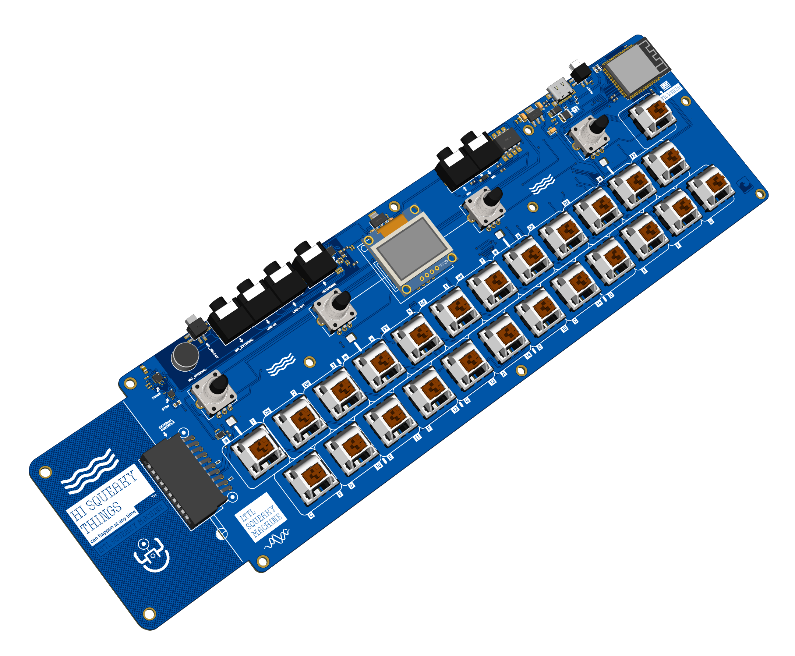

The exendable:


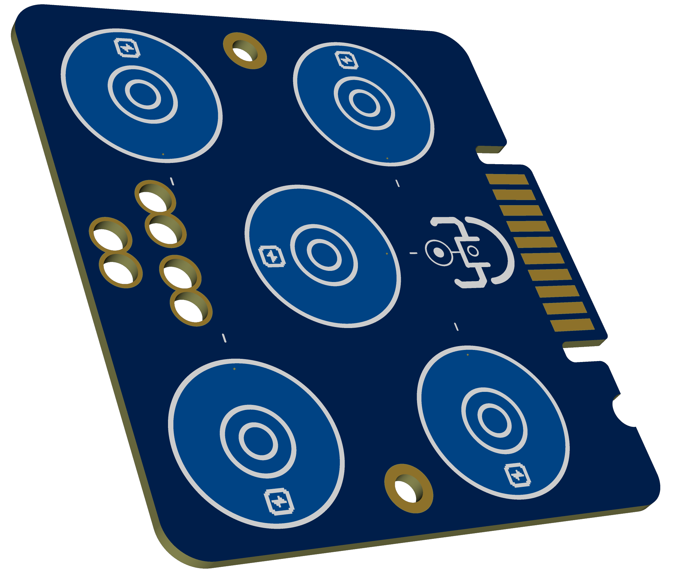

### Revision 3.0 

We are iterating on revision 3.0. We produced a small batch of five and are testing the hardware and software intensively. 


> [!CAUTION]
A small batch of this revision has been fabricated. Use the schematics and layouts at your own risk because the new design in `docs/images` has not been fully tested yet. We are testing this revision with different types of key switches, caps, and colors.

Rendered versions:

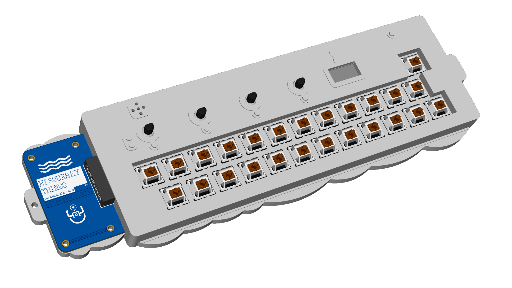
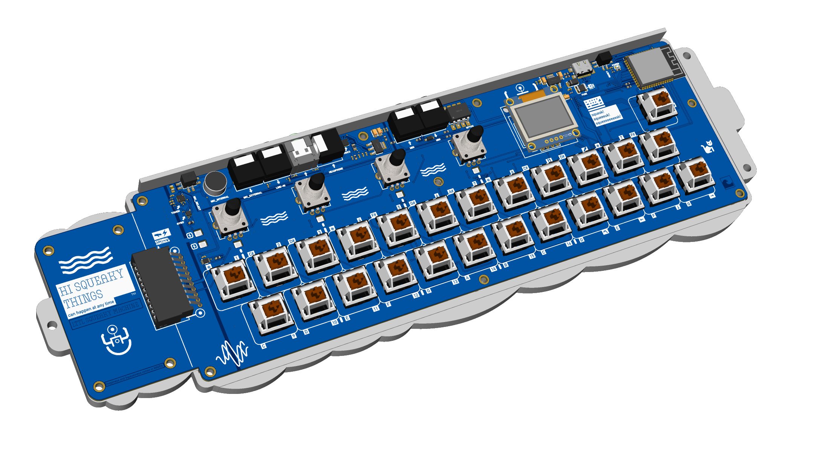

- [Specification and capabilities](docs/images/specs.md)
- [Pin layout of the ESP32S3 based MCU](docs/images/pinout.md)
- [Fabrication files](fabrication)

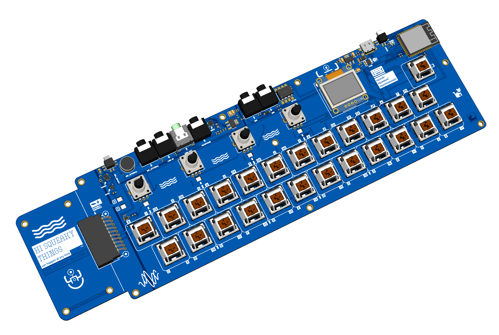

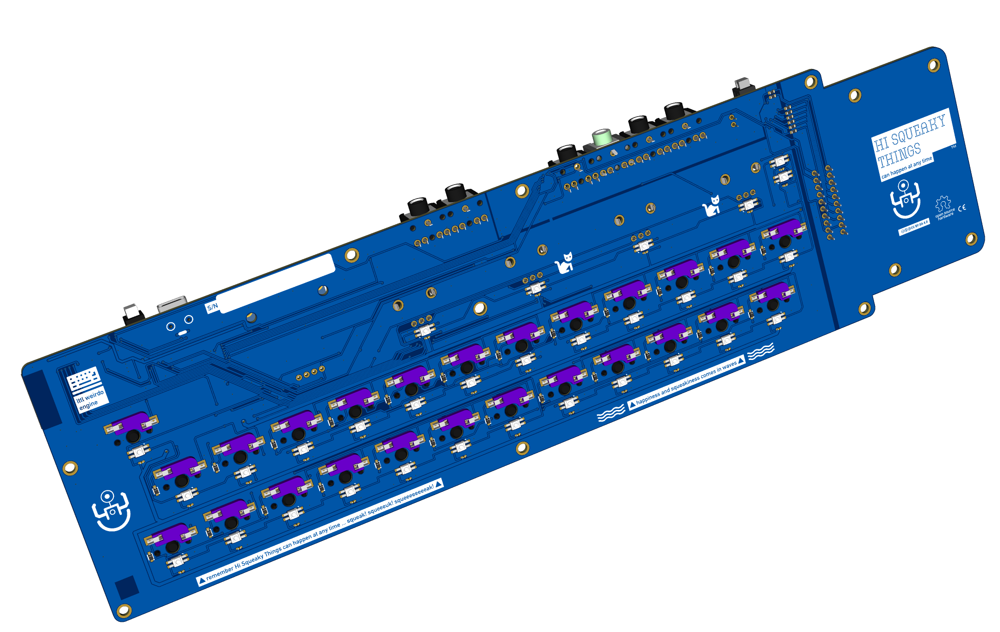


### Revision 2.0 

This is the first production-ready hardware running firmware that uses [Little Weirdo Software Synthesizer](https://github.com/hi-squeaky-things/little-weirdo) for sound synthesis.

> [!CAUTION]
A small batch of this revision has been fabricated. Use the schematics and layouts at your own risk because the new design in `docs/images` has not been fully tested yet. We are testing this revision with different types of key switches, caps, and colors.

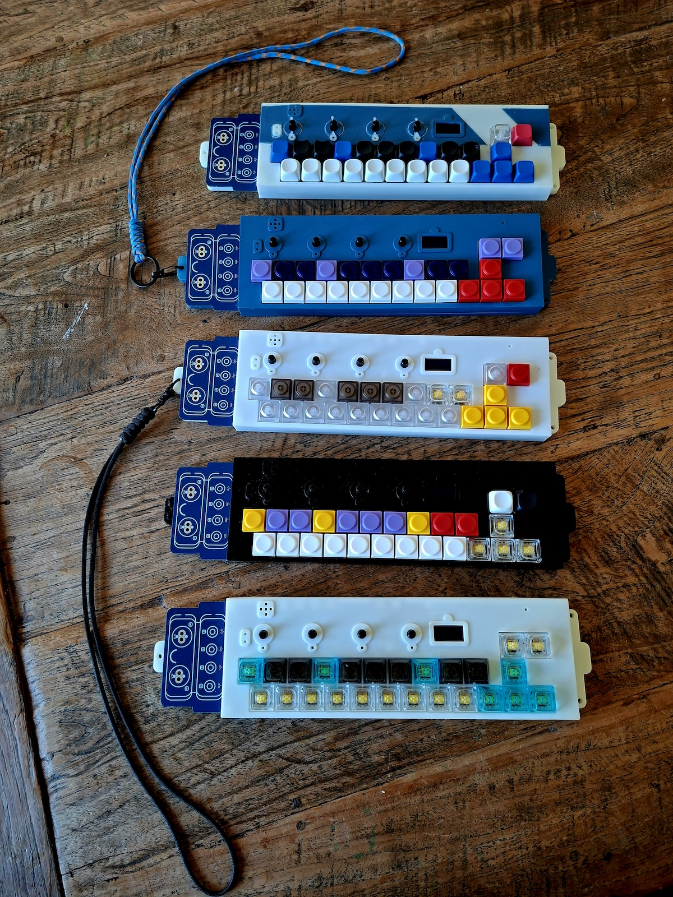

Rendered versions:

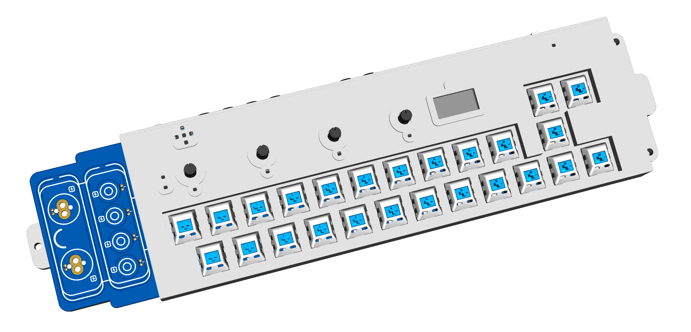
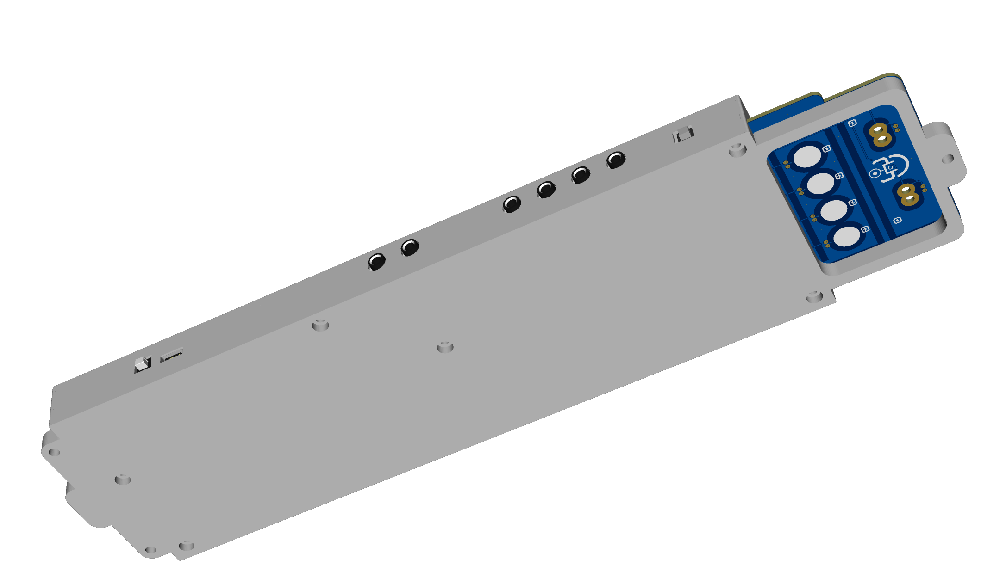
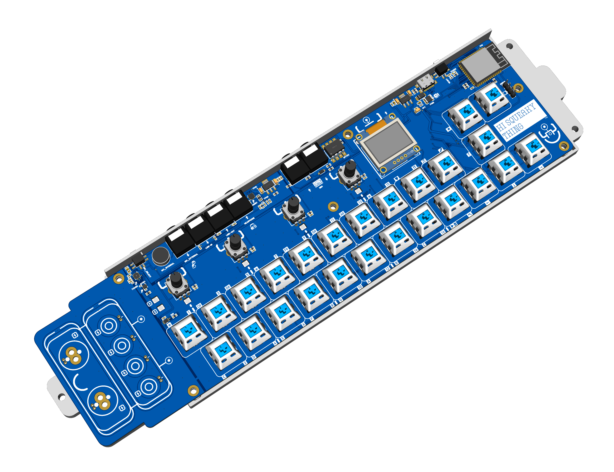
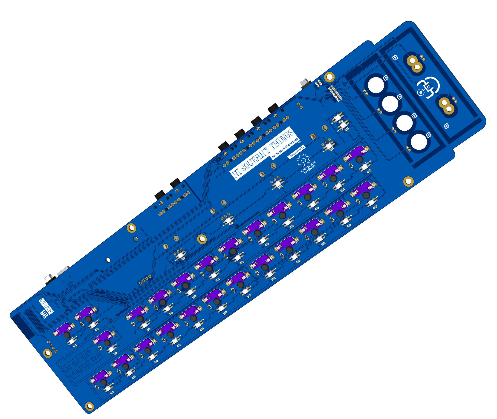


### Revision 1.0

This is the first prototype we created and ran with firmware that uses [Little Weirdo Software Synthesizer](https://github.com/hi-squeaky-things/little-weirdo) for sound synthesis. This revision was only a proof of concept for some features and was not intended for production use.

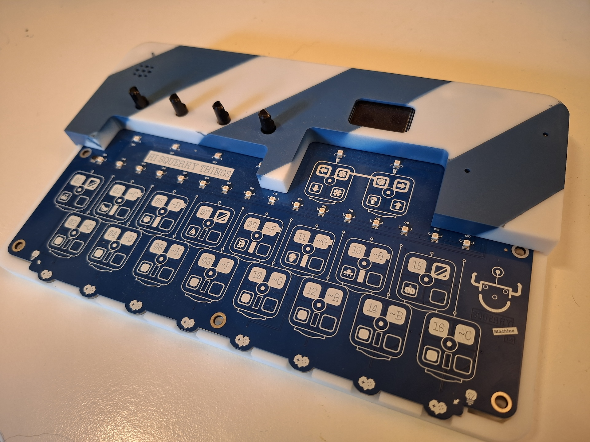
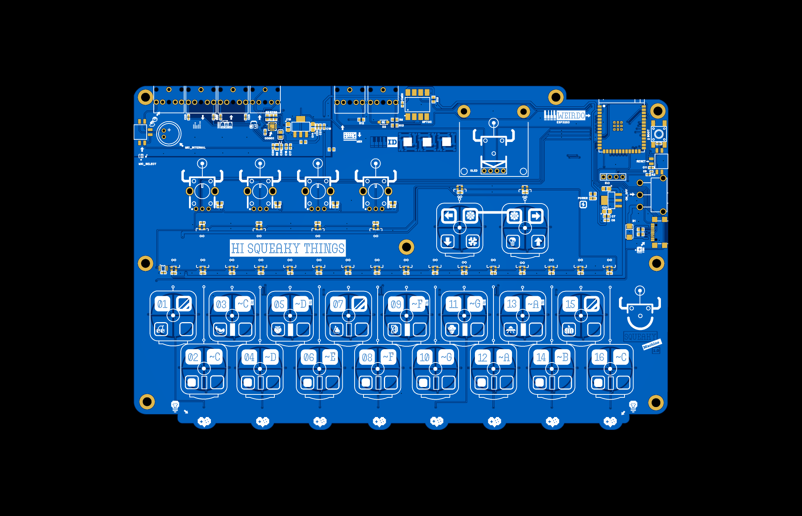

## License

This work is licensed under a
[Creative Commons Attribution-NonCommercial-ShareAlike 4.0 International License][cc-by-nc-sa].

[![CC BY-NC-SA 4.0][cc-by-nc-sa-image]][cc-by-nc-sa]

## Credits

Made by Daniël, owner of Hi Squeaky Things Lab.
