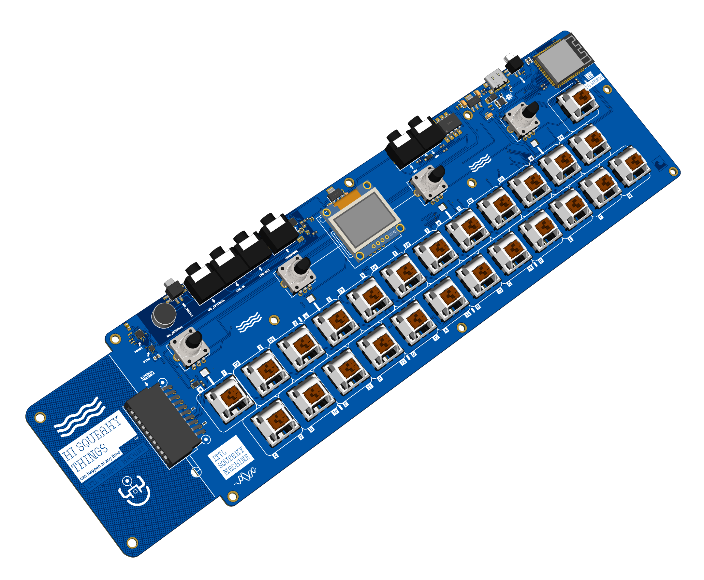

# Welcome!

The Little Squeaky Machine is a hardware reference platform for the [Little Weirdo software synthesizer](https://github.com/littleweirdo-studio/little-weirdo). It is designed to run the [Little Squeaky Machine firmware](https://github.com/littleweirdo-studio/little-squeaky-machine-firmware).

Yes! This documentation is for you if you want to build, hack, remix the hardware or start creating a new firmware for the ↓↓↓↓↓↓

```ruby
 ⡇ ⡇⢹⠁⢹⠁⡇ ⣏⡉ ⢎⡑⡎⢱⡇⢸⣏⡉⣎⣱⣇⠜⢇⢸ ⡷⢾⣎⣱⡎⠑⣇⣸⡇⡷⣸⣏⡉
 ⠧⠤⠇⠸ ⠸ ⠧⠤⠧⠤ ⠢⠜⠣⠪⠣⠜⠧⠤⠇⠸⠇⠱ ⠇ ⠇⠸⠇⠸⠣⠔⠇⠸⠇⠇⠹⠧⠤

 top view      ╭━━━━━━━━━━━━━━━━━━━━━━━━━━━━━━━━━━━━━━━━━━━━━━━━━━━━━━━━━━━━━━━━━━━━━━━━━━━━╮
╭━━━━━━━━━━━━━━╯    ╭MIC╮                                                                   │
│                   │ ♫ │                 ╭────────────╮                                    │
│                   ╰───╯                 │ LttL       │                                    │
│           ╡    ╭0╮               ╭1╮    │ Squeaky    │   ╭2╮               ╭3╮     ╭═M═╮  │
│           ╡    │◉│               │◉│    │ Machine ♫  │   │◉│               │◉│     │░░░│  │
│           ╡    ╰─╯               ╰─╯    ╰────────────╯   ╰─╯               ╰─╯     ╰▀▀▀╯  │
│ external ─╡   ╭─0─╮ ╭─C─╮ ╭─D─╮ ╭─1─╮ ╭─F─╮ ╭─G─╮ ╭─A─╮ ╭─2─╮ ╭─C─╮ ╭─D─╮ ╭─3─╮ ╭─F─╮     │
│ interface ╡   │░░░│ │ # │ │ # │ │░░░│ │ # │ │ # │ │ # │ │░░░│ │ # │ │ # │ │░░░│ │ # │     │
│           ╡   ╰───╯ ╰▀▀▀╯ ╰▀▀▀╯ ╰───╯ ╰▀▀▀╯ ╰▀▀▀╯ ╰▀▀▀╯ ╰───╯ ╰▀▀▀╯ ╰▀▀▀╯ ╰───╯ ╰▀▀▀╯     │
│           ╡      ╭─C─╮ ╭─D─╮ ╭─E─╮ ╭─F─╮ ╭─G─╮ ╭─A─╮ ╭─B─╮ ╭─C─╮ ╭─D─╮ ╭─E─╮ ╭─F─╮        │
│                  │   │ │   │ │   │ │   │ │   │ │   │ │   │ │   │ │   │ │   │ │   │        │
│                  ╰───╯ ╰───╯ ╰───╯ ╰───╯ ╰───╯ ╰───╯ ╰───╯ ╰───╯ ╰───╯ ╰───╯ ╰───╯        │
╰━━━━━━━━━━━━━━╮                                                                            │
               ╰━━━━━━━━━━━━━━━━━━━━━━━━━━━━━━━━━━━━━━━━━━━━━━━━━━━━━━━━━━━━━━━━━━━━━━━━━━━━╯
```


First things first. With the loaded firmware you have a good starting point. Don’t read the manual! Just plug it in with a USB-C cable `#!ruby [1]` into a power bank, your mobile phone, a power adapter, or a laptop and connect some headphones `#!ruby [2]`


```ruby
                                                        [1] ⇉ PLUG IT IN!!!
  rear view                                                        ⬇   
╭━━━━━━━━━━━━━━━━━━━━━━━━━━━━━━━━━━━━━━━━━━━━━━━━━━━━━━━━━━━━━━━━━━━━━━━━━━━━╮
│ ╭─╮     ┎─MIC-IN  ┎─LINE-OUT           ┎─MIDI-IN               ╭───╮ ╭─╮   │
│ ╰┳╯     ◉    ◉    ◉     ◉              ◉     ◉                 ╰─┳─╯ ╰┳╯   │
│ MIC EX/IN    ┖─LINE-IN  ┖─HEADPHONE ⇇ [2]    ┖─MIDI-OUT         USB RESET  │
╰━━━━━━━━━━━━━━━━━━━━━━━━━━━━━━━━━━━━━━━━━━━━━━━━━━━━━━━━━━━━━━━━━━━━━━━━━━━━╯
```              

!!! warning "Use a good quality (shielded) cable and a (low noise) USB-C power source capable of supplying 15 W (5 V/3 A)"

Some lights will turn on, and the logo will appear on the display. Use the red key `#!ruby [1]` to open the menu. Turn the rightmost encoder `#!ruby [2]` to select what you want to control. Press the red key `#!ruby [1]` again, then play some notes and use the encoders to change the parameters of the machine.

```ruby  
 top view      ╭━━━━━━━━━━━━━━━━━━━━━━━━━━━━━━━━━━━━━━━━━━━━━━━━━━━━━━━━━━━━━━━━━━━━━━━━━━━━━━━━╮
╭━━━━━━━━━━━━━━╯   ╭MIC╮                                                           [1] ⇉ HIT ⇇  │
│                  │ ♫ │                  ╭────────────╮               [2] ⇉ TURN ⇇      ↓↓↓    │
│                  ╰───╯                  │ LttL       │                      ⬇          ⬇     │
│           ╡    ╭─╮               ╭─╮    │ Squeaky    │   ╭─╮               ╭─╮        ╭═M═╮   │
│           ╡    │◉│               │◉│    │ Machine ♫  │   │◉│               │◉│        │░░░│   │
│           ╡    ╰─╯               ╰─╯    ╰────────────╯   ╰─╯               ╰─╯        ╰▀▀▀╯   │
│ external ─╡   ╭#0─╮ ╭─C─╮ ╭─D─╮ ╭#1─╮ ╭─F─╮ ╭─G─╮ ╭─A─╮ ╭#2─╮ ╭─C─╮ ╭─D─╮ ╭#3─╮ ╭─F─╮ ╭─G─╮   │
│ interface ╡   │░░░│ │ # │ │ # │ │░░░│ │ # │ │ # │ │ # │ │░░░│ │ # │ │ # │ │░░░│ │ # │ │ # │   │
│           ╡   ╰───╯ ╰▀▀▀╯ ╰▀▀▀╯ ╰───╯ ╰▀▀▀╯ ╰▀▀▀╯ ╰▀▀▀╯ ╰───╯ ╰▀▀▀╯ ╰▀▀▀╯ ╰───╯ ╰▀▀▀╯ ╰▀▀▀╯   │
│           ╡      ╭─C─╮ ╭─D─╮ ╭─E─╮ ╭─F─╮ ╭─G─╮ ╭─A─╮ ╭─B─╮ ╭─C─╮ ╭─D─╮ ╭─E─╮ ╭─F─╮ ╭─G─╮      │
│           C      │   │ │   │ │   │ │   │ │   │ │   │ │   │ │   │ │   │ │   │ │   │ │   │      │
│                  ╰───╯ ╰───╯ ╰───╯ ╰───╯ ╰───╯ ╰───╯ ╰───╯ ╰───╯ ╰───╯ ╰───╯ ╰───╯ ╰───╯      │
╰━━━━━━━━━━━━━━╮                                                                                │
               ╰━━━━━━━━━━━━━━━━━━━━━━━━━━━━━━━━━━━━━━━━━━━━━━━━━━━━━━━━━━━━━━━━━━━━━━━━━━━━━━━━╯
```

Let’s start squeaking! If you want to know more, turn to the relevant chapter in this manual.

Have fun! Squeakiness comes in waves—and don’t forget: §QυεΛΛΛΛκκ Cαη ħαρρεη α⊥ αηψ тıмε!